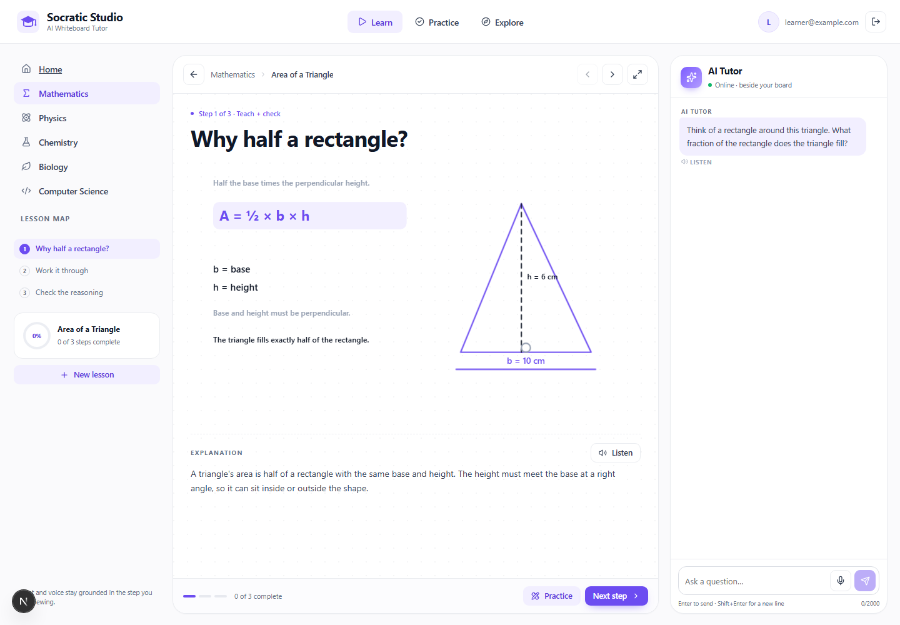

# Chalkovox

An AI whiteboard tutor. Enter a topic and the app draws a short visual lesson, narrates each step, checks understanding, and answers follow-up questions in a chat that can read the board. Voice input and narration use Deepgram; lessons and answers use OpenRouter.



## Stack

Next.js 15 (App Router) · TypeScript · Supabase Auth (`@supabase/ssr`) · OpenRouter · Deepgram (Nova STT + Aura TTS) · Zod · Vitest · Lucide icons.

## Quick start

This checkout is already connected to the live `chalkline` Supabase project through `.env.local`. Add AI provider keys to enable lessons, chat, and voice:

```bash
npm install
# add OPENROUTER_API_KEY to .env.local; Deepgram is already configured
npm run dev
```

Open http://localhost:3000, sign in at `/login`, and start a lesson. For a fresh copy without `.env.local`, run `cp .env.example .env.local` and fill in the Supabase values first. The live project requires email confirmation for new signups.

### Environment

| Variable | Purpose |
| --- | --- |
| `NEXT_PUBLIC_SUPABASE_URL` | Supabase project URL |
| `NEXT_PUBLIC_SUPABASE_ANON_KEY` | Supabase publishable key (legacy anon key also works) |
| `OPENROUTER_API_KEY` | Server-side model access |
| `OPENROUTER_BASE_URL` | OpenAI-compatible gateway (default `https://openrouter.ai/api/v1`) |
| `OPENROUTER_MODEL` | Model slug (default `google/gemini-2.5-flash`) |
| `DEEPGRAM_API_KEY` | Transcription and speech |
| `NEXT_PUBLIC_SITE_URL` | Origin for email confirmations (default `http://localhost:3000`) |
| `LOG_TO_FILE` | Write JSONL request logs to disk (default `true`; set `false` on read-only serverless hosts) |
| `LOG_DIR` | Log directory (default `logs`) |
| `LOG_LEVEL` | `debug`, `info` (default), `warn`, or `error` |
| `LOG_MAX_FILES` | Daily log files to keep (default `14`) |
| `LOG_CONSOLE` | Mirror log lines to stdout (default `false`) |

Only `NEXT_PUBLIC_*` values reach the browser. Provider keys are read exclusively in server modules.

## Supabase

The live project is `chalkline` (`lpmzaqadgkoehafzfxtw`, Mumbai). Its URL and publishable key are in `.env.local`; auth URL settings are versioned in [`supabase/config.toml`](supabase/config.toml) and linked to the hosted project.

- Site URL: `http://localhost:3000`
- Allowed callbacks: `http://localhost:3000/auth/callback`, `http://127.0.0.1:3000/auth/callback`

To change auth settings, edit `supabase/config.toml`, then:

```bash
npx supabase@latest config diff
npx supabase@latest config push --yes
```

Add your production origin and `https://YOUR_DOMAIN/auth/callback` before deploying. No SQL, tables, or RLS policies are required: Supabase is used for authentication only. Lessons are session state. Email confirmation is enabled, so confirm your address before the first sign-in. The hosted database password is in `.supabase-db-password` (untracked); move it to a password manager and delete the file. Full setup and verification notes: [`docs/08-live-supabase.md`](docs/08-live-supabase.md).

## Using the studio

- **Learn** returns to the current board. **Practice** opens the step's quick check, or asks the tutor for one. **Explore** / **New lesson** starts a new topic.
- Step dots and the sidebar map show progress; **Finish** on the last step opens the completion summary.
- **Listen** reads a step or tutor answer with Deepgram; the mic in the chat composer records a question and inserts the transcript.
- Use **Export PPTX** to download one PowerPoint slide per lesson step. **Export video** creates a narrated recording in WebM, or MP4 when the browser supports MP4 recording.
- Ask for simpler explanations, examples, or practice in the chat. Answers are grounded in the visible step.

## Request logs

Every page and API request is written as one JSON line to `logs/app-YYYY-MM-DD.log`. API and auth handlers log method, path, status, duration, and application error code; pages are logged by middleware (Node.js runtime). Query strings, headers, cookies, and bodies are never logged. Each response carries an `x-request-id` header that matches its log entry.

```bash
tail -f logs/app-$(date -u +%F).log
```

File logging requires a writable filesystem (`next dev` / `next start`). On read-only serverless hosts, set `LOG_TO_FILE=false` and use the platform log drain. Details: [`docs/11-request-logging.md`](docs/11-request-logging.md).

## API routes

| Route | Auth | Input | Output |
| --- | --- | --- | --- |
| `POST /api/lesson` | Yes | `{ topic, level }` | `{ lesson }` validated JSON |
| `POST /api/chat` | Yes | `{ messages, stepIndex, context? }` | Plain-text token stream |
| `POST /api/voice/transcribe` | Yes | `multipart/form-data` `audio` | `{ transcript }` |
| `POST /api/voice/speak` | Yes | `{ text }` (≤600 chars) | `audio/mpeg` |
| `GET /auth/callback` | — | `code` or `token_hash`/`type` | Redirect to a safe path |
| `POST /auth/signout` | — | — | Clears cookies, redirects |

Errors use `{ error: { code, message } }`. Routes return 401 unauthenticated, 400 invalid input, 402 when the AI account has insufficient balance, 413/415 for audio issues, 429 for provider rate limits, 502 for provider failures, and 503 when a server key is missing.

## Scripts

```bash
npm run dev        # development server
npm run build      # production build
npm start          # production server
npm run typecheck  # tsc --noEmit
npm test           # Vitest, 52 cases
```

## Project structure

```
src/
  app/                 pages, auth callback, API routes
  components/
    auth/ chat/ quiz/ tutor/ voice/ whiteboard/ brand/
  lib/
    ai/ auth/ deepgram/ env/ lesson/ logging/ supabase/ api/
  middleware.ts        session refresh, route gating, page request logs
tests/                 schemas, providers, route handlers, request logging
supabase/config.toml   hosted auth configuration (linked project)
docs/                  plan, step completion notes, screenshots
logs/                  runtime JSONL request logs (gitignored)
```

The lesson contract lives in `src/lib/lesson/schema.ts`: a 1000×600 canvas with `text`, `line`, `arrow`, `circle`, `rect`, `dot`, and `path` primitives. The model output is validated before rendering; invalid output gets one repair attempt.

## Verification status

- TypeScript, Vitest (52/52), and the production build pass.
- Request logging verified live: page and API entries are written to `logs/app-2026-11-17.log`, include status/duration/error code, omit query strings and headers, and echo `x-request-id`.
- Landing, login, and studio were visually checked at 1440×1000; screenshots are in `docs/screenshots/`.
- **Live Supabase auth verified:** valid sign-in reached `/tutor`, invalid credentials showed the friendly error, sessions survived reload, `/tutor` redirected to `/login?next=/tutor` when signed out, and sign-out cleared cookies. The temporary test user was deleted. See [`docs/08-live-supabase.md`](docs/08-live-supabase.md).
- **Live Deepgram verified:** the client’s Aura TTS → Nova STT round trip passed, and authenticated `/api/voice/speak` + `/api/voice/transcribe` returned `audio/mpeg` and a transcript; unauthenticated calls returned 401. See [`docs/09-live-deepgram.md`](docs/09-live-deepgram.md).
- **AI gateway configured, balance blocked:** the supplied key reaches `https://api.apinex.bond/v1` (45 models, `gemini-3.8-flash` selected), but completions return 402 because the account has no balance. Authenticated `/api/lesson` correctly returns `402 AI_PAYMENT_REQUIRED`. See [`docs/10-live-ai-gateway.md`](docs/10-live-ai-gateway.md).

## Limitations

- Lessons and chat history are not persisted; a refresh starts over.
- The AI's diagrams are best-effort; complex geometry may need a narrower topic.
- Narration is capped at 600 characters per request.
- Microphone access requires localhost or HTTPS.
- New accounts must confirm their email; the live project keeps confirmations enabled.
- AI generation is blocked until the configured gateway account is topped up; voice and auth are live.
